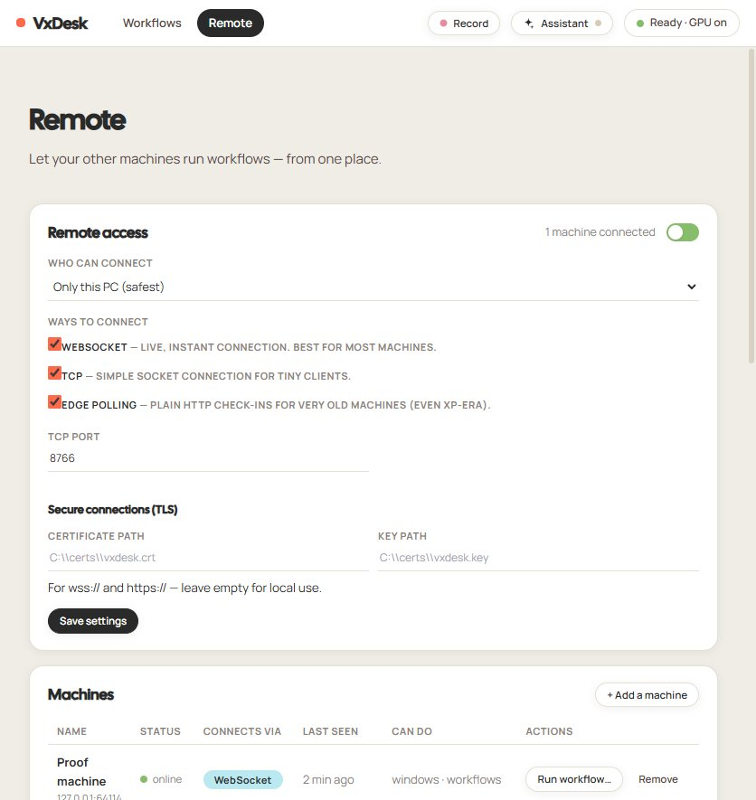

<div align="center">

# VxDesk

**Fully-local desktop automation with an n8n-style visual workflow editor.**
*"Playwright MCP, but for the desktop."*

[](LICENSE)
[](https://github.com/Huntz-Group/VxDesk/releases)
[](#-choose-your-path)
[](docs/architecture.md)
[](docs/architecture.md)
[](docs/architecture.md)

[Download](#-path-a-install-the-desktop-app-recommended) ·
[Run from source](#-path-b-run-from-source-developers) ·
[Docs](https://huntz-group.github.io/VxDesk/) ·
[Report a bug](https://github.com/Huntz-Group/VxDesk/issues/new?template=bug_report.md) ·
[Request a feature](https://github.com/Huntz-Group/VxDesk/issues/new?template=feature_request.md)

</div>

Build automation flows by dragging nodes onto a canvas: find an image or text on screen
(GPU-accelerated), click it, type data from a CSV row, branch on conditions, loop over
datasets. Everything runs on your machine — **no cloud, no telemetry**. Windows-first,
architected so capture/input/vision backends can be swapped for macOS/Linux later.

---

## 📖 Table of contents

- [Choose your path](#-choose-your-path)
  - [Path A — Install the desktop app](#-path-a-install-the-desktop-app-recommended)
  - [Path B — Run from source](#-path-b-run-from-source-developers)
- [Your first workflow in 5 minutes](#-your-first-workflow-in-5-minutes)
- [The editor at a glance](#-the-editor-at-a-glance)
- [Recorder — record once, replay forever](#-recorder--record-once-replay-forever)
- [AI Assistant — chat your way to a workflow](#-ai-assistant--chat-your-way-to-a-workflow)
- [MCP server — let AI drive your desktop](#-mcp-server--let-ai-drive-your-desktop)
- [Remote services — drive other machines](#-remote-services--drive-other-machines)
- [Testing](#-testing)
- [Building the installer yourself](#-building-the-installer-yourself)
- [Repo layout](#-repo-layout)
- [Safety](#-safety)
- [Contributing & license](#-contributing--license)

---

## 🧭 Choose your path

| | **Path A — Install** | **Path B — From source** |
|---|---|---|
| Who | You want to automate your desktop | You want to hack on VxDesk |
| Needs | Windows 10/11, nothing else | Windows 10/11, Python 3.12, Node ≥ 20 |
| Time | ~2 minutes | ~5 minutes |

### 📦 Path A — Install the desktop app (recommended)

1. Grab **`VxDeskSetup-x.y.z.exe`** from the
   [latest release](https://github.com/Huntz-Group/VxDesk/releases/latest).
2. Run it. Windows may show a SmartScreen *"unknown publisher"* prompt — the build is
   intentionally unsigned; click **More info → Run anyway**.
3. Launch **Start Menu → VxDesk**. It installs to `%LOCALAPPDATA%\Programs\VxDesk`
   (no admin rights needed); your workflows and settings live in `%LOCALAPPDATA%\VxDesk`
   and survive uninstalls.

The GPU stack (**DXcam** capture + **DirectML** OCR) is bundled — no Python, Node, or
browser install required; the UI runs in a native WebView2 window. Runtime is fully
offline except optional AI-assistant LLM calls.

> [!TIP]
> Handy exe flags: `VxDesk.exe --server-only` (API only, no window),
> `VxDesk.exe --browser` (default browser instead of the native window).

### 🛠️ Path B — Run from source (developers)

**Prerequisites:** Python 3.12 and Node.js ≥ 20 on your PATH.

```bash
git clone https://github.com/Huntz-Group/VxDesk.git
cd VxDesk
npm run setup   # one-time: creates backend venv, installs Python + npm deps
npm run dev     # starts backend (127.0.0.1:8765) + editor UI (localhost:7100)
```

Open the printed URL. That's it — two sample workflows are pre-loaded (see below).

> [!NOTE]
> First launch downloads RapidOCR model files (~15 MB) the first time OCR runs.

<details>
<summary><b>🐧 macOS / Linux?</b></summary>

Not yet. Capture (DXcam/DXGI) and input (pywin32) are Windows backends, but they're
behind pluggable interfaces in `backend/vxdesk/capture/` and `backend/vxdesk/input/` —
porting is a matter of writing new backend modules. Contributions welcome; see
[CONTRIBUTING.md](CONTRIBUTING.md).

</details>

---

## 🚀 Your first workflow in 5 minutes

VxDesk ships with two sample workflows so you can see results immediately:

| Sample | What it does | Safe? |
|---|---|---|
| **Welcome · VxDesk tour** | Variables, templating, a condition branch, and a screenshot saved to `runs/` | ✅ No mouse/keyboard input — the perfect first run |
| **Notepad · Hello** | Launches Notepad, focuses it, types a message you can edit in the **Variables** tab | ⚠️ Real keyboard input |

**Try it now:**

1. Start VxDesk (either path above) and open the UI.
2. In the workflow list, click **Welcome · VxDesk tour (safe)**.
3. Press **▶ Run** and watch the live console stream each node's result.
4. Open `runs/` — there's your screenshot, saved by the last node.

**Then build your own — the data-driven pattern:**

```
Data Table (CSV) ──▶ Loop ──body──▶ your actions using {{ item.column }}
                       │
                       └──done──▶ continues after the last row
```

1. Drag a **Data Table** node onto the canvas and point it at any CSV.
2. Drag a **Loop** node; connect Data Table → Loop, then wire your action nodes
   (Click, Type, Find Image…) to the Loop's **`body`** handle.
3. In any text field, reference the current row with `{{ item.column_name }}` —
   the same `{{ node.output }}` templating works everywhere.
4. Flip the **dry-run toggle** on the run bar to rehearse without touching the
   mouse/keyboard, then run for real.

<details>
<summary><b>🧩 Full node catalog (v1) — click to expand</b></summary>

| Category | Nodes |
|---|---|
| Triggers & data | `trigger.manual` · `input.data_table` |
| Control flow | `control.loop` · `control.condition` · `control.wait` · `control.wait_for` · `control.set_variable` · `control.log` |
| Capture & vision | `capture.screenshot` · `vision.find_image` · `vision.find_text` |
| Actions | `action.click` · `action.move` · `action.drag` · `action.type_text` · `action.press_key` · `action.focus_window` · `action.launch` |
| Scripting & output | `script.python` · `output.save_screenshot` |

</details>

---

## 🖥️ The editor at a glance

An n8n-style canvas: drag nodes, wire outputs to inputs, configure each node in a
schema-driven property panel, and watch runs live over WebSocket.

| Piece | Tech | Why |
|---|---|---|
| Workflow engine | Python DAG executor | loops, conditions, variables, `{{ node.output }}` templating, dry-run, stop-aware |
| Screen capture | **DXcam** (DXGI Desktop Duplication) | GPU-side capture, ~120+ fps; `mss` fallback |
| OCR | RapidOCR on **ONNX Runtime DirectML** | any DX12 GPU (AMD/Intel/NVIDIA), CPU fallback |
| Image matching | OpenCV multi-scale template matching | threshold + region + scale control per node |
| Input | pyautogui / pywin32 | clicks, drags, typing, hotkeys, window focus; failsafe corner ON |
| Editor | React + Vite + React Flow | n8n-style canvas, schema-driven panels, live run console |
| AI integration | MCP stdio server | lets an AI agent screenshot / find / click / type / run workflows |

---

## 🎬 Recorder — record once, replay forever

Click **● Record**, do the task once yourself — VxDesk captures your clicks, typing,
hotkeys, and window switches (Esc or **Stop** finishes). Review the steps, pick a mode,
and it becomes a normal workflow you can fine-tune in the editor:

- **Smart (recommended)** — each click becomes *Find Image* (a template cropped at the
  click point) + *Click*, so the workflow still works if things move a little.
- **Exact positions** — replays raw coordinates; fastest, but breaks if windows move.

Typing is merged into single Type steps, pauses become Wait steps (capped at 5 s), and
window switches become Focus steps.

> [!CAUTION]
> The recording bar reminds you that **everything you type is captured** — avoid
> passwords while recording.

Full contract: [docs/recorder.md](docs/recorder.md)

---

## ✨ AI Assistant — chat your way to a workflow

Click **✦ Assistant** in the header and tell it what you want:
*"Make a workflow that types my standup notes into Notepad"*, *"run the report workflow in
practice mode"*, *"delete the old test workflow"*. The assistant creates workflows
(auto-validated, self-correcting), runs them (practice mode by default for anything that
touches the mouse/keyboard), and manages your library — you watch each action as a chip
in the chat.

It works with **any OpenAI-compatible endpoint**, fully local if you want:

| Provider | Base URL | Key? |
|---|---|---|
| Ollama (local) | `http://localhost:11434/v1` | no |
| LM Studio (local) | `http://localhost:1234/v1` | no |
| OpenAI / OpenRouter / Moonshot (Kimi) / custom | cloud | yes — stored locally, never displayed |

Pick one in the assistant's **settings** (gear icon). No LLM is bundled; everything
except the model call stays on your machine. Tip: no GPU-heavy model needed —
a 7B instruct model with tool-calling support (e.g. `qwen2.5:7b` in Ollama) works well.
`scripts/mock_llm.py` provides a fake endpoint for testing the assistant without a model.

Full contract: [docs/ai-assistant.md](docs/ai-assistant.md)

---

## 🤖 MCP server — let AI drive your desktop

```bash
cd backend
.venv/Scripts/python.exe -m vxdesk.mcp_server
```

Tools exposed: `screenshot`, `find_image`, `find_text`, `click`, `type_text`,
`press_key`, `list_windows`, `run_workflow`. Point any MCP-compatible client at that
command (stdio transport).

---

## 🌐 Remote services — drive other machines

Enable on the **Remote** page (off by default): pick a bind address (keep `127.0.0.1`
unless you really need LAN access), then **Add agent** to mint a token — shown once,
stored hashed. Transports: WebSocket `/ws/remote`, TCP JSON-lines on port 8766, and a
stdlib-only edge polling API (`/api/edge/*`) for legacy machines.



<details>
<summary><b>Full agent on the remote machine</b></summary>

```bash
python -m vxdesk.agent --server ws://HOST:8765 --token <token> --agent-id <id> --name "Shop PC"
# add --dry-run-default to force practice mode; tcp://HOST:8766 also works
```

</details>

<details>
<summary><b>Legacy / XP-class machines (Python 2.7+ / 3.4+, zero dependencies)</b></summary>

```bash
python edge/vxdesk_edge.py --config vxdesk_edge.ini   # shell commands only
```

</details>

> [!WARNING]
> **Security**: remote control is powerful — bind localhost unless you need LAN, treat
> agent tokens like passwords, and configure TLS (cert/key paths in Remote settings;
> `scripts/make_dev_cert.ps1` makes a dev pair) before exposing anything beyond your
> machine. TLS runs on a second listener (main port + 2) so the local UI stays HTTP.
> `scripts/install-agent-service.ps1` registers the agent as a hidden logon task.

Full contract: [docs/remote-services.md](docs/remote-services.md)

---

## 🧪 Testing

```bash
backend/.venv/Scripts/python.exe -m pytest backend/tests -q   # 134 tests
cd frontend && npm test                                       # 12 tests (vitest)
backend/.venv/Scripts/python.exe scripts/integration_check.py # live checks (server must be running)
```

The backend suite runs against a **virtual screen** (synthetic images), so it never
touches your real desktop. `scripts/integration_check.py` verifies the real stack:
DXcam capture, GPU OCR probe, workflow CRUD, validation, and an end-to-end run.

---

## 🏗️ Building the installer yourself

One command builds everything:

```bash
backend/.venv/Scripts/python.exe scripts/build_desktop.py
```

This (1) builds the frontend (`npm.cmd --prefix frontend run build`), (2) runs
PyInstaller (`packaging/vxdesk.spec`) into `dist/VxDesk/`, and (3) compiles
`packaging/vxdesk.iss` with Inno Setup (`tools/innosetup/ISCC.exe`) into
`installer-output/VxDeskSetup-x.y.z.exe`. Flags: `--skip-frontend`, `--skip-installer`.

One-time tool setup: `packaging/make_icon.py` regenerates the app icon; Inno Setup 6
goes into `tools/innosetup/` (its installer supports `/VERYSILENT /DIR=<abs path>` for
a local, portable-style install).

> [!NOTE]
> **Signing:** the build is intentionally **unsigned**. If you distribute publicly, add
> a code-signing certificate and wire `signtool` into `build_desktop.py` plus Inno's
> `SignTool`/`SignedUninstaller` directives.

---

## 🗂️ Repo layout

```
backend/     Python package vxdesk + venv + pytest suite
frontend/    React Flow editor (Vite dev server, proxies /api + /ws)
workflows/   Your workflows as plain JSON (+ .runs/ history)
assets/      Template images for find-image nodes
packaging/   icon + PyInstaller spec + Inno Setup script
scripts/     dev.js (orchestrator), setup.js, integration_check.py, build_desktop.py, samples/
edge/        Zero-dependency polling agent for legacy machines
plugins/     Kimi Work plugin wrapper (AI drives VxDesk via MCP)
docs/        Architecture + API contracts (published as the docs site)
```

---

## 🛡️ Safety

- **Dry-run toggle** on the run bar: logs every action without touching mouse/keyboard.
- PyAutoGUI failsafe is enabled — slam the mouse into a screen corner to abort input.
- Stop button cancels a run within ~200 ms, even inside wait/poll loops.
- Workflows and run history are plain JSON files you can diff, back up, and version.
- Remote access is **off by default**; agent tokens are hashed and revocable.

Found a security issue? Please follow [SECURITY.md](SECURITY.md) — do **not** open a
public issue.

---

## 🤝 Contributing & license

Contributions are welcome — bug reports, feature ideas, node types, ports. Read
[CONTRIBUTING.md](CONTRIBUTING.md) and the [Code of Conduct](CODE_OF_CONDUCT.md) first.

**Deep-dive docs:** [architecture](docs/architecture.md) ·
[API contract](docs/api-contract.md) · [recorder](docs/recorder.md) ·
[AI assistant](docs/ai-assistant.md) · [remote services](docs/remote-services.md) —
also browsable at **https://huntz-group.github.io/VxDesk/**.

VxDesk is open source under the [MIT License](LICENSE).
